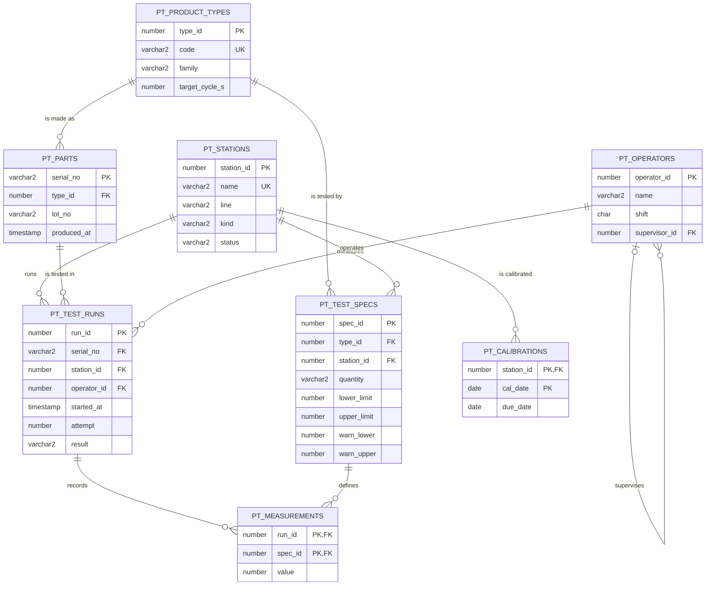

# Production-Test Database

[](https://github.com/HannaBeshoy/production-test-db/actions/workflows/ci.yml)

**Database Systems course project** · University of Debrecen, Faculty of Informatics · Oracle SQL (tested on Oracle Database 23ai Free and PostgreSQL 16), Python · **complete: runs in CI on both databases**

A database for the end-of-line test area of a small factory: parts, test stations, test specifications with limits, test runs, measurements, operators and calibrations. It is designed from an ER model to tables in third normal form, filled with a week of generated data that hides a few real problems, and queried with **24 queries covering every lab-test exercise type (groups A to E)**. Each query answers a question a quality engineer would actually ask, and each result is checked against the same answer computed independently in Python.

- [x] Schema: 8 tables, primary and foreign keys, CHECK and UNIQUE constraints, indexes for the joins ([sql/01_schema.sql](sql/01_schema.sql))
- [x] Generated data: 450 parts, 1,080 test runs, 1,380 measurements, deterministic ([tools/gen_data.py](tools/gen_data.py))
- [x] 24 queries: projection and selection, aggregation, self, inner and outer joins, 0D/1D/2D subqueries, IN / ANY / ALL / EXISTS, MINUS / INTERSECT / UNION, ROWNUM, DELETE and UPDATE with subqueries, and four complex analyses ([queries/](queries/))
- [x] **24 tests pass on Oracle and on PostgreSQL** in GitHub Actions: every result equals the Python reference

## The schema



The [project guide](docs/PROJECT_GUIDE.md) explains every design decision: why the limits live in a separate specification table, why a retest is a new row with an attempt number instead of an overwritten result, and the normalization to 3NF.

## What the queries find

The generated week has problems built in; the queries find each of them without being told where to look:

| Finding | Query | Result |
| --- | --- | --- |
| LEAK-1 is the worst station | A2 | 5.16 % of its runs fail, against 0.85 to 2.79 % elsewhere |
| ...because its seal is wearing | E3 | mean leak 0.93 → 1.74 sccm from Monday to Friday; Cpk 1.14 → 0.25 |
| The wear could have been caught on **Wednesday** | E3 | 2 readings already beyond Monday-Tuesday's 3σ warning limit on Wednesday; the first failure came on Thursday |
| Friday's clutch units suffer | E1 | first-pass yield 73.3 % on Friday, against 90 to 93 % on other days |
| Three clutch units shipped without a leak test | C4 (MINUS) | CRU-200-261103-007, -261104-015, -261105-022: passed end-of-line, never at a leak station; final yield 96.7 % on those days |
| A new station is idle | B3 (OUTER JOIN) | LEAK-3 with 0 runs; an inner join would hide it |
| A calibration is overdue | D3 | TORQ-2, due on 20 October |
| Retests "rescue" 22 failures | C4 (INTERSECT) | first attempt FAIL, second attempt PASS at the same station: worth asking whether the retest is honest |

Every query result is in [results/](results/) as CSV. The data is generated with deliberately wide spreads, so most Cpk values are below 1; the point is the trend and the method, not the absolute numbers.

## The lab-test exercise types

| Group | Exercise type | Query |
| --- | --- | --- |
| A | non-aggregated (selection, LIKE, built-in functions, sorting) | A1_afternoon_clutch_units |
| A | aggregated (COUNT, SUM, AVG, HAVING) | A2_station_fail_rate |
| B | self-join | B1_operators_and_supervisors |
| B | inner join | B2_out_of_limit_measurements |
| B | aggregated outer join | B3_station_load_outer_join |
| C | non-aggregated 0D subquery | C1_same_lot_as_failed_part |
| C | aggregated 0D subquery | C2_slow_runs |
| C | 1D subquery: IN, NOT EXISTS, ALL, ANY | C3_in_failed_leak, C3_not_exists_never_failed, C3_all_above_monday, C3_any_operators |
| C | MINUS, INTERSECT, UNION | C4_escapes_minus, C4_rescued_intersect, C4_attention_union |
| C | aggregating the aggregates of a 2D subquery | C5_daily_fail_rate_of_leak1 |
| C | ROWNUM over an ordered 2D subquery | C6_top5_leak_rownum |
| D | DELETE with 0D / 1D subquery | D1_delete_old_calibrations, D2_delete_aborted_leak_runs |
| D | UPDATE with 0D / multi-column subquery | D3_update_overdue_stations, D4_update_warning_limits |
| E | complex | E1_first_pass_yield, E2_cpk_per_quantity, E3_leak1_daily_trend, E4_operator_shift_failures |

## Running it

In SQL Developer, DataGrip or VS Code connected to an Oracle database (as in the course labs): run `sql/01_schema.sql`, then `sql/02_data.sql`, then any file in `queries/`. The D queries change data: run `ROLLBACK` afterwards to undo them.

With Python:

```bash
pip install -r requirements.txt pytest
# PostgreSQL (createdb prodtest first):
python tools/runsql.py --pg "dbname=prodtest" --reset queries/E3_leak1_daily_trend.sql
python -m pytest -v tests
# Oracle (for example Oracle Database Free in Docker: gvenzl/oracle-free):
DB=oracle ORACLE_DSN="prodtest/prodtest@localhost:1521/FREEPDB1" python -m pytest -v tests
```

The queries are Oracle SQL. On PostgreSQL, `tools/runsql.py` translates them with sqlglot (VARCHAR2, NUMBER, NVL, MINUS, ...) and rewrites the one construct sqlglot leaves, `WHERE ROWNUM <= n`, into `LIMIT n`.

## Repository layout

```text
sql/        01_schema.sql (tables, constraints, indexes), 02_data.sql (generated)
queries/    24 queries, one file each, named by lab-test group
tools/      gen_data.py (the data and its story), runsql.py (runs on Oracle or PostgreSQL)
tests/      test_queries.py: each result against an independent Python computation
results/    the result of every query as CSV
docs/       project guide
```

## Author

Beshoy Hanna · Computer Science Engineering BSc, University of Debrecen · [LinkedIn](https://www.linkedin.com/in/beshoy-hanna-8b52213a0)
